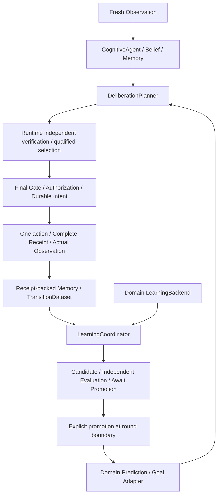

# 共通認知ループとReceipt-backed学習

## 承認された範囲

PreActは世界モデルの機能をモジュール化し、認知・予測・シミュレーション・
意思決定・実行・実経験からの更新を統合する。今回の縦切りはQueueとSoftwareで
共通制御を動かす。任意の環境への対応や未知タスクへの汎化は証明対象ではない。
機能的完成と正しさを優先し、計算資源を測定する。

追加条件: Softwareの既知候補に関する実結果の学習と未知候補への汎化を区別する。
protected evaluator/oracleの非公開情報を予測器へ渡さない。H1の指標は専用の
Prediction/Goal Adapterで直接評価し、平均指標から仮想Stateを生成しない。
昇格はround境界で明示操作し、Planner/Adapter/Registry/selectorを整合して再構成する。
Coordinatorは制御のみを担い、特徴量・Health・評価・予測はBackendへ委譲する。

## 接続

`CognitiveAgent(learning_coordinator=..., episode_id=...)`は判断前と確定Receipt取得後に
Coordinatorを呼ぶ。未指定経路は従来どおり。Agentは1 episodeの所有者、Coordinatorは
複数の実episodeからの学習状態の所有者である。



`RoundBinding`でPlanner、Registry、Worldのdispatch wrapper、selectorと根拠をまとめる。
既存SelectionWorldは予測根拠・完全State・Store tokenをfresh observationとintent後にも
確認する。CandidateSelectorはpureな読み取りのみ。学習処理をselector内で実行しない。
予測・昇格は実行許可ではなく、CoreのVerifier/Gate/Authorizationは変更しない。

## ドメインの差

Queueは既存ContinuousQueueAdaptation、QueueServiceAdapter、Drift、Recoveryを再利用する。
一つのWorld/episodeを保ち、正式観測から監視・失効・再学習を進める。独立H3評価と
16有効学習標本・8比較・新鮮な監視の昇格条件は変更しない。評価環境は明示的な
operatorのfactoryで指定し、実Worldのprivate scheduleを読まない。失効したPromotionを
通常Guardへ戻して利用しない。

Softwareは既存ProgramWorldの許可された候補コードのみを実行する。
ProgramOutcomeAdapterは公開コードの語彙を入力にし、complete Receiptの
Goal達成・test_pass_fractionのみを教師にする。TabularDynamicsTrainerと
LearnedDynamicsEngineを再利用する。既知候補の条件付き実績平均であり、未知のコードや
別タスクへの汎化ではない。未知feature cellはunknown、H3/sequenceは未対応。

Softwareの固定初期条件: 各候補4学習標本、各候補4独立評価標本、準備最大16実行。
昇格条件: coverage 100%、Goal予測MAE ≤ 0.25、固定事前0.5より悪化しない、全根拠検証成功。
準備実行は公開候補の観測不足を基準にし、失敗結果も実経験として残す。
実episodeを分離し、準備・評価の実行数/費用はタスク評価とは別に報告する。
SoftwareのHealthは評価済み語彙への適用可能性であり、QueueのFisher drift検出を
Softwareへ一般化したものではない。

## 昇格・復元・予算

`LearningCoordinator.promote(candidate, world)`が明示API。判断中には拒否する。
評価合格だけではactiveにしない。Backendの再検証とdurable記録後に次roundへ接続する。
テストハーネスのround_observerは明示APIを呼ぶoperatorであり、本番の自動昇格ではない。
再起動は既存Store/Artifactsを読み直し、未確定実行は照合まで拒否する。
失敗・取消はCoordinatorを利用不可にし、旧モデル/未承認候補へ暗黙にfallbackしない。

Runtimeの提案・検証呼出しは既存usage/reservation契約を維持する。学習・独立評価は
別の明示された局所予算とdeadlineに従い、CPU/wall・実行件数・呼出しを記録する。
外部API費用0と、未算定のローカル計算費用は区別する。学習込みのepisode wall期限を
超えた場合、次のRuntime実行へ進まない。

## 検証・限界

単体/統合否定テスト、専用のpilotと固定本評価、元Receiptからの独立監査を行う。
比較は既存方式・固定予測・昇格なし・学習と明示昇格。予測改善と実Action変化を
別々に測定し、Baseline性能優位を受入条件にしない。過去protocol/resultsは保存する。

単一所有者・append-only Storeの保証範囲を維持する。強い分散整合性、任意コードの
隔離、新しいPhysical統合、自動Promotion、汎用ニューラルモデルは今回の非目標。

## 使用例

```python
from preact.cognition import CognitiveAgent, Goal, LearningCoordinator, WorldPlanner
from preact.core.models import Policy
from preact.core.registry import Registry
from preact.datasets.programs import LOGIC
from preact.domains.program import ProgramWorld
from preact.domains.program_learning import ProgramLearningBackend
from preact.engines.local import LocalHeuristic, LocalVerifier

prototype = ProgramWorld(LOGIC[0])
backend = ProgramLearningBackend(
    store, artifacts, prototype,
    evaluation_factory=lambda i: ProgramWorld(LOGIC[0], evaluation_seed=100 + i),
)
learning = await LearningCoordinator.create(backend)

# Use a NEW actual World and Agent for each short Software task.
world = ProgramWorld(LOGIC[0], seed=11, evaluation_seed=11)
agent = CognitiveAgent(
    store, artifacts, Registry([LocalHeuristic(world), LocalVerifier(world)]),
    WorldPlanner(world), [Goal(name="Repair", metric="goal_complete", target=1)],
    Policy(search=False, width=2, max_nodes=2, max_calls=64, calibration=False),
    learning_coordinator=learning, episode_id="actual-task-1",
)
result = await agent.run(world, max_rounds=1)
# Repeat actual preparation tasks until backend reports await_promotion.
# Explicit operator call; a failed evaluation cannot be overridden:
# await learning.promote(backend.candidate, next_actual_world)
# After restart, construct a fresh Backend and call:
# learning = await LearningCoordinator.restore(backend, journal_id, next_actual_world)
```

再現コマンド（出力先は必ず新規）:

```sh
PYTHONPATH=src uv run python -m scripts.bench_common_learning \
  --protocol benchmarks/common-learning-v2.json \
  --output .cache/common-learning-new --report .cache/common-learning-new-results.json
PYTHONPATH=src uv run python -m scripts.audit_common_learning \
  --bundle .cache/common-learning-new --output .cache/common-learning-new-audit.json
```

Queueの初期監視/回復準備は明示的なreadiness方策である。VOIやタスク性能の改善を
新たに主張するものではなく、PR #16のTaskAware方策と凍結済み結果は維持する。
実行可能性・計算費用と実タスクへの利益は別々に評価する。

測定は[結果文書](common-cognitive-learning-results.md)を参照。最終の再現protocolは
`benchmarks/common-learning-v2.json`（32ケース）である。上記コマンドもv2を指定している。
旧pilotは純粋なFeature Adapterの抽出前の探索結果として保存し、現行source hash付き
v2本評価と区別する。
