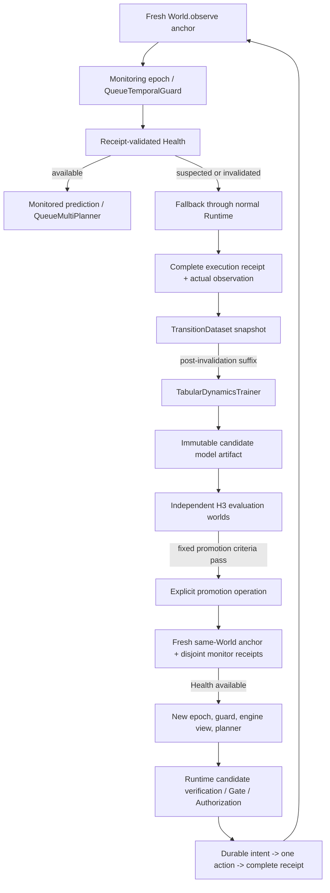

# Continuous Queue Model Adaptation (v1)

This Queue v2 vertical slice tests repeated model recovery while one real World
instance and one World episode remain alive. It reuses receipt-backed transitions,
the existing tabular trainer, drift monitor, recovery evaluation and promotion
contracts. `ContinuousQueueAdaptation` is lifecycle orchestration; it is not a
Runtime, execution ledger or authority source.



## Episode and data contracts

An epoch anchor is the exact `observed` Queue v2 `State` returned by
`World.observe()`. Mid-episode anchors are opt-in through
`QueueTemporalGuard(allow_same_episode=True)` and are bound to an explicit
`monitoring_epoch`. Existing tick-zero/separate-episode Guard behavior remains the
default. Runs and receipts remain disjoint between training, monitoring, recovery
suffixes and evaluation; only the real World episode label is shared where a
continuous split is explicitly declared. Run-head fences, receipt checks, task and
State continuity, timestamp cutoffs and model/dataset hashes are replayed. Lifecycle
records are immutable artifacts referenced by append-only Store events. Restore
reconstructs epoch lineage, invalidation evidence and current Health; an invalidated
model cannot become usable merely because the process restarted.

Each model generation has a new epoch and Health scope. A generation starts at a
fresh observed anchor after candidate evaluation. Only new, complete, receipt-backed
monitoring observations in that epoch can make its Health available. A failed or
interrupted promotion does not clear the parent's invalidation or make its forecast
available. Promotion is an explicit API call; the runtime does not autonomously
promote a candidate.

Single-World interactions reveal only the outcome of the executed action. The v1
protocol does not label unexecuted actions. Candidate H3 accuracy is evaluated in
separate, declared evaluation Worlds using the existing Queue recovery contract;
those counterfactual comparisons are not observations from the continuous episode.
They are independent by episode/run/receipt provenance, but remain deterministic,
Queue-specific evaluations and do not establish stochastic generalization. Health
and continuous learning metrics use only ordered source-World receipts, so policy
selection bias, censoring and temporal correlation remain limitations.

## Fixed pilot protocol and observed result

Reproduce with:

```bash
uv run python scripts/benchmark_queue_continuous.py \
  --protocol benchmarks/queue-continuous-v2.json \
  --output NEW_PRIVATE_DIR --result NEW_RESULT.json
uv run python scripts/audit_queue_continuous.py \
  --bundle NEW_PRIVATE_DIR --output NEW_AUDIT.json
uv run python scripts/benchmark_queue_continuous.py \
  --protocol benchmarks/queue-continuous-v3-high-low-high.json \
  --output NEW_PRIVATE_DIR --result NEW_RESULT.json
```

The fixed v2 case is seed 409, 160-tick World, goal 10,000 (an intentionally
uncapped long-horizon task), Low ticks [0,24), High [24,64), Low [64,104), High
[104,160), with Queue v2 probe cost .05, submit cost .15 and holding cost .25.
Model A is receipt-trained on a separately declared Low source episode. The one
adaptation World then runs without reset. Each invalidated generation uses the
first Health invalidation cutoff, 16 post-cutoff informative probes for training,
the fixed independent Queue recovery evaluation (8 comparisons), and 8 fresh
same-World monitor probes before explicit promotion. All actual executed probe and
decision runs are included in the continuous TransitionDataset.

The v2 run completed 100 source-World transitions, with invalidations at ticks 36
and 75. Model A selected `submit(1)`, promoted Model B selected `submit(3)`, and
promoted Model C selected `submit(1)`. Each selected Action ran through the normal
CognitiveAgent/Runtime path and has a complete receipt and actual observation.
Both candidate evaluations passed with 8/8 coverage, candidate state MAE 0,
candidate Action-difference MAE 0, and zero unknowns. Parent-model and prior-baseline
errors were nonzero (full values in `reports/queue-continuous-v2-results.json`).
The independent auditor reconstructed 100 continuous transitions, both promotions
and all three selected/executed decisions; unsafe executions were zero.

This is a deterministic owned fixture, not a generalization result. The control
World using always-`submit(1)` achieved reward 84.0 and delivered 99 over 100 ticks;
the adaptation trace reward was -1.6, delivered 4, and holding loss 0. This poor
task return is material: repeated sensing/recovery consumes ticks and cost, and the
current lifecycle policy does not show improved closed-loop utility. The experiment
demonstrates repeated same-World model invalidation, learning, independent evaluation,
explicit promotion and model-dependent real action choices; it does not demonstrate
that this adaptation strategy improves task performance. The initial v1 pilot at
submission cost .10 was retained separately and did not change the A/B/C action;
v2's .15 cost was declared in a separate protocol to create a predeclared decision
condition, without tuning the value function after observing v1 results.

Runtime, Gate, verifier, Authorization, durable-intent and receipt meanings are not
changed. Inference never becomes an observation or a safety proof. Queue-specific
continuous monitoring is opt-in and does not define PreAct's general world-model
contract.

## Limits / next work

The full recovery benchmarks cover both Low→High→Low and High→Low→High using one
fixed seed each; the high→low→high measurements are recorded separately in
[`continuous-adaptation-results.md`](continuous-adaptation-results.md). Unit tests
cover stable-low, a deterministic low regime with occasional high ticks, and an
uninformative ordinary action. They do not estimate false-alarm rates under a
stochastic distribution. The benchmarks do not include multiple random seeds,
candidate-evaluation rejection in a full continuous episode, or a complete
process-kill-at-every-promotion-write fault campaign. Same-episode
recovery uses an explicitly separate continuous-split contract; it does not relax
the original RecoveryPolicy or Safety Authority. The fixed minimum sample counts
and H3 promotion criteria remain unchanged. No automatic retraining, promotion,
rollback, generic online learning or counterfactual observation is implemented.
Next work should test abort/restart at each durable transition, failed-candidate
rejection in the same continuous episode, noisy/partial-observation adaptation and
whether the sensing/recovery cost can be justified by measured task utility.
