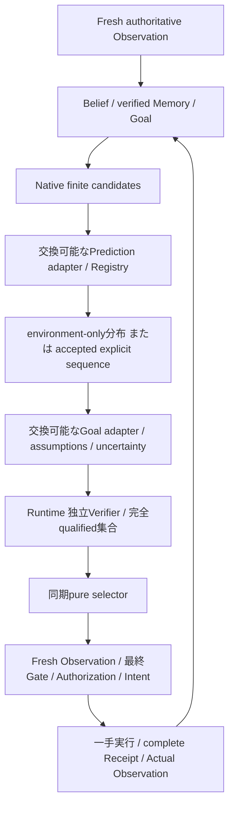

# Modular Counterfactual Deliberation v1

## 監査と最小設計

公開main d7d4547976117ba76559c86309620ff53efa2fddからのopt-in追加。
Core Searchは既にHypothetical Stateの探索・backup・独立Gate・一手実行を持つ。
Registryは複数Action requestのaccepted single-step prediction、明示Claim、conditions、
SequenceConditioningを検証する。新たな探索RuntimeやLedgerは作らない。
LocalHeuristicのcapabilityはH1のみであり、そのままH2 requestを渡すことは未対応。
QueueTemporalEngine/Guard/RecoveryはH3 environment-onlyを既に提供し、平均vectorsは
再投入可能なStateではない。Queueのexplicit intervention sequenceは今回unsupported。

共通DeliberationPlannerはWorldPlannerのreceipt-backed Context、有限候補、Prediction
Adapter、Goal Adapter、同期CandidateSelectorを組み合わせる。予測と価値はpropose時に
既存Storeへ保存し、Runtimeが独立に確定したqualified集合内だけで選ぶ。
既存QueueMultiSelectionWorldのdispatch処理はState/Action/Storeの構造契約のみを使い、
Queue式を使わないため、そのままSoftwareにも再利用する（名前と型注釈はlegacy）。
Core、既存Queue Planner、Guard/Recovery/Promotion、安全証拠の意味は変更しない。

Software adapterはLocalHeuristicのH1 successorをRegistryで受理し、その実在しない
仮想Stateに対してnative proposeを行う。最後のstepを既存LocalHeuristicで計算する小さな
sequence envelope engineを追加し、明示Claimとaccepted lineageでRegistryに再検証させる。
一手のenvironment-onlyと明示介入sequenceは別形式として記録する。
Queue adapterはMonitoredQueueSource.compareのH3分布をそのまま使う。短期baselineも
H3を取得し、Goal adapterの評価projection=1だけを変える。H3 PredictionをH1へ偽装しない。
Queueの枝は既存有限service pathsのまま評価し、平均Stateの生成や次stepへの投入をしない。



## 実験と反証条件

Owned Software fixtureは既存の許可済みcheckout patchesだけを使う。再利用可能なvalidator
を段階導入するTaskで、即時修正→準備→統合と、準備→統合を比較する。これは宣言した
workflow/Goalの差であり、新しいコード生成能力や因果理解ではない。
Core Search・短期・sequenceを同じWorld/候補/Verifierで比較する。Core Searchが同等なら
同等として報告し、既存Coreにlookaheadがなかったと主張しない。
Queueでは正式Runtimeの別training episodeと監視warmup receiptを用い、準備tick/費用を含める。
学習／固定事前、短期／H3、noise、誤予測、情報不足／失効を比較する。
Pilotと固定本評価を分離し、固定後にGoal/重み/seedを変更しない。

受入: 同じ共通比較器を2 domain/2 Goal adapterで動かし、少なくとも1条件で短期と未来
比較の選択が変わり、実Action/Receiptまで反映される。複数roundのActualから再計画する。
Unknown、binding/lineage/version/根拠改ざん、予算不足、取消は不正実行を生まない。
独立auditは保存された成功フラグでなく、予測条件・Goal値・qualified集合・Actual binding
を再計算する。未実行枝を教師やActualにしない。性能改善・汎用優位は測定結果で別に判断する。

## 限界

v1は最大3 root候補、最大3 step、最大2 Software follow-up候補、有限分岐である。
Goal値と予測不確実性の係数はモデル仮定で、校正や安全証明ではない。
Softwareは既知の決定論的patch materializationで、ニューラルDynamicsではない。
Queueの独立性/定常性、Health scope、単一所有者append-only整合性境界は既存契約を継承する。
selectorは信頼されたin-process pure拡張であり、OS sandboxではない。

## 実際の利用例（既存Runtimeへ委譲）

```python
from preact.cognition import CognitiveAgent, Goal
from preact.cognition.deliberation import DeliberationPlanner
from preact.core.models import Policy
from preact.core.registry import Registry
from preact.core.store import Store, Artifacts
from preact.domains.software import SoftwareWorld
from preact.domains.software_deliberation import SoftwarePredictionAdapter, SoftwareGoalAdapter
from preact.domains.queue_multi_selection import QueueMultiSelectionWorld
from preact.engines.local import LocalHeuristic, LocalVerifier

world = SoftwareWorld()
store = Store("sqlite:///NEW_DIR/ledger.db")
artifacts = Artifacts("NEW_DIR/artifacts")
planner = DeliberationPlanner(
    world, SoftwarePredictionAdapter(world, store, horizon=2), SoftwareGoalAdapter()
)
agent = CognitiveAgent(
    store, artifacts, Registry([LocalHeuristic(world), LocalVerifier(world)]), planner,
    [Goal(name="Repair checkout", metric="goal_progress", target=1)],
    Policy(search=False, width=2, max_nodes=2, max_calls=64, calibration=False),
    candidate_selector=planner,
)
# Async caller: every round re-observes, verifies all roots and executes at most one.
result = await agent.run(QueueMultiSelectionWorld(world, planner), max_rounds=4)
```

通常のSoftwareWorldは従来どおり2手で完了する。WorkflowSoftwareWorldは比較用に別Taskと
追加workflow_progressを宣言するowned fixtureであり、通常Worldを変更しない。
Software adapter v1はtrusted LocalHeuristicとローカル候補生成に限定する。
任意の外部Engine/非決定論的生成器を、費用0やsequence対応と仮定して差し替えない。
交換性は同じDeliberationPlannerにSoftware/Queueの異なるRegistry利用・Goal adapterを
接続した実証であり、すべてのEngineへ無条件にsequenceを合成する能力ではない。

Queueでは既存MonitoredQueueSourceをQueuePredictionAdapterへ渡し、QueueGoalAdapterを
使う。訓練・監視run manifestと実anchorは既存Guardで検証する。昇格済みsourceの
Recoveryがactiveを失った場合には通常Guardへ戻さず停止する。利用不能Healthや未対応
continuationはスコアなしでABSTAINする。これは実行安全性の証明ではない。

## 記録と計算予算

`deliberation`イベントは完全State/Belief/Goal、verified Memory参照、adapter signature、
source更新token、全候補のrequest/Prediction/path/価値/順位とローカル計測を保存する。
Runtimeの`candidate_qualification`と`candidate_selection`はこれとは別記録である。
`cognitive_multi_dispatch`が予測seal、選択Action、fresh State、Authorization、Intentを
結び付け、`outcome`とcomplete execution recordのみが実行を証明する。Memoryは従来の
EpisodicMemoryを使い、枝・Hypothetical Stateやdeliberationイベントは経験に登録しない。
Software H2/H3のsequence envelopeと内部H1計算は両方を実使用量へ計上する。
Registryの新規計算・既存Guardの再検証を含む上限をproposal_callsで予約し、usageで
実績を返して未使用分を返金する。同期selectorは追加計算やIOをしない。
CPU/wall、API費用（ローカル構成では0）と金額換算していない計算費用（null）を区別する。
CognitiveAgentのepisode-wide budgetsとRuntimeの呼出し・deadline検査を引き続き使う。

## 再現と独立監査

```sh
uv run python -m scripts.bench_deliberation \
  --protocol benchmarks/deliberation-v1.json --output NEW_PRIVATE_BUNDLE \
  --report NEW_RESULTS.json
uv run python -m scripts.audit_deliberation \
  --bundle NEW_PRIVATE_BUNDLE --protocol benchmarks/deliberation-v1.json \
  --results NEW_RESULTS.json --output NEW_AUDIT.json
uv run pytest -q tests/test_deliberation.py
```

新しいディレクトリを必ず指定する。Ledger、full State、コード内容、モデルartifactは
private bundleに保持し、公開resultsはAction名/fingerprintと数値要約だけである。
Auditorはnative候補/有限leaf集合、Registryのaccepted lineage、モデルのreceipt-backed再学習、
時系列Health、Goal値、独立Verifierの再実行、Runtime qualified集合、最終Gate、
Authorization/Intent/complete Receiptと実Outcomeを照合する。予測IDとhypothetical Stateの
生成時刻は意味比較で除外するが、authoritative Stateの時刻・内容は除外しない。
Sourceが変更された場合は旧結果を更新せず、新outputで再評価する。
[実測・反例・費用](modular-deliberation-results.md)を参照。
