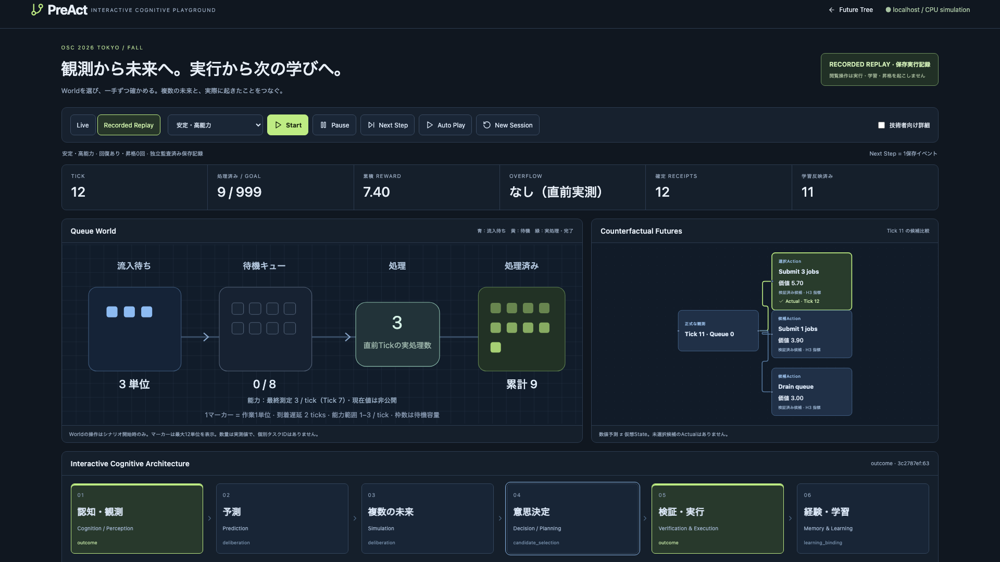
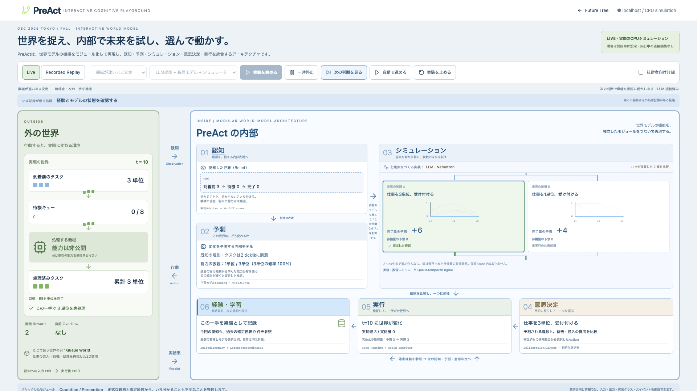

# OSC Interactive Cognitive Playground

PreAct modularly reproduces world-model functions and integrates cognition,
prediction, simulation, decision and execution. The exhibition presents this closed
loop: the environment is observed, an internal representation supplies uncertain
action futures, a decision becomes one real action, and its confirmed experience is
retrieved by the following cognitive round. It uses the real
`CognitiveAgent`, `DeliberationPlanner`, `LearningCoordinator`, `QueueLearningBackend`
and domain-independent Core Runtime. It does not implement a second agent, safety
gate, training coordinator or executor.

## Prepare before the exhibition

Use the repository checkout, Python3.12 and Node22+ on the exhibition computer.
Install dependencies and compile the UI while networking is available:

```sh
uv sync --python 3.12 --frozen --extra dev --extra physical --extra sandbox
npm --prefix web ci
npm --prefix web run contracts
npm --prefix web run build
```

The reviewed replay catalog is included in `assets/playground/recordings/`.
No benchmark reproduction or API key is needed to view it. Keep the checkout,
`.venv`, built `web/dist`, local artifacts and replay assets on the computer.
The standalone wheel does not contain the website/assets; this exhibition launch
procedure uses the source checkout. No external fonts, CDN or model download is
required at run time.

## Launch on localhost

From the repository root, with the prepared dependencies:

```sh
PREACT_MODE=local PREACT_KIOSK=1 \
PREACT_DATABASE_URL=sqlite:///.preact/exhibit.db \
PREACT_ARTIFACTS_DIR=.preact/exhibit-artifacts \
PREACT_PLAYGROUND_ROOT=.preact/exhibit-sessions \
.venv/bin/preact serve --host 127.0.0.1 --port 8000
```

Open `http://127.0.0.1:8000/#playground`. Kiosk mode also opens the playground from
the root URL. It uses local artifact storage even if an unrelated S3 bucket is in
the operator's environment. The health endpoint reports the validated replay count
and any rejected archives:

```sh
curl --fail http://127.0.0.1:8000/api/health
```

Expected: `status=ok`, `kiosk=true`, `playground_replays=6`,
`playground_replay_errors=[]`. Check the actual values before opening the booth.
Binding remains localhost; a network-facing deployment is outside this setup.

Normal service mode, without `PREACT_KIOSK=1`, retains Software/Physical execution,
the default Future Tree and a link to the playground. Queue preparation/evaluation
runs do not displace Software/Physical history in that UI. Kiosk mode rejects the
generic run, cancellation, arbitrary artifact, ledger and API documentation routes
on the server. Public Queue requests accept a scenario, bounded seed and fixed module-composition preset only. They
cannot provide policies, code, state, private schedules, models or promotions.
Live preparation, evaluation and cognitive runs retain the server-owned Policy
limits, including calibration. The historical benchmark replays retain their
original policies and are explicitly recorded, not newly executed.

## A thirty-second visitor path

1. Start with the two large regions: **outside World** and **inside PreAct**.
   Queue World is the concrete environment used to show the architecture. Accepted
   work travels to a queue, is processed by a machine and becomes completed work.
   Its actual capacity is hidden; a square denotes a fungible work unit, not a job ID.
2. Inside, **cognition** turns a formal observation into an internal representation.
   **prediction** combines known arrival/conservation rules with the learned service
   distribution. These are distinct from the outside World and its private schedule.
3. **Simulation** branches into saved candidate futures. Lines represent numerical
   queue paths; the large numbers are predicted additional completed work. These
   are model calculations under no further acceptance, not complete future States.
   **Decision** narrows these alternatives to one verified action.
4. Follow **execution** back across the Action boundary to the World. Its Receipt
   supplies the actual result. **Experience/learning** returns confirmed experience
   to the following cognitive round. Learning, independent evaluation and explicit
   promotion remain separate stages.
5. Click `この循環を再生` to rewind to the observation of this real round and follow
   its actual stage records. `次の処理を見る` visits the next original observation,
   deliberation, selection, authorization, intent, confirmed outcome or update.
   Several functions can share one deliberation record; no separate timestamps are
   invented. Bright connectors mean supporting source records, not measured latency.

The default audited stable-high Replay opens on a completed round with processed
work, after readiness probes. The three native branches compare accept3, accept1
and accept0. Clicking an alternative inspects it without executing it. The selected
candidate alone receives Actual. Newly accepted work arrives two ticks later, so
just-completed work may have been accepted earlier.

All six module roles and implementation families appear in the ordinary diagram.
`技術者向け詳細` exposes implementation classes, exact input/output records, State,
Action, Prediction, Gate, Receipt and model identifiers. Switching views preserves
the cursor and creates no executions. Technical Next Step visits every original
stored event. Live always admits one real round and pauses at its observer boundary.

Select stable-low or a change scenario to view its own independently audited run.
Low-to-High's adverse result remains visible. Automated layout/record checks are not
human comprehension evidence; rehearse this path with a new visitor before OSC.

## Real module implementations and composition

The diagram is backed by the following existing contracts and implementations:

| Function | Implementation | Actual data passed onward |
| --- | --- | --- |
| Cognition | Observation adapter, WorldPlanner, CognitiveAgent | Formal State, Belief and receipt-backed memory references |
| Action proposals | Native Queue candidates, or ModelProposer + local Nemotron | State-bound existing Action candidates |
| Prediction | QueueLearningBackend binding + QueuePredictionAdapter | Guarded learned service distribution or explicitly labelled fixed prior |
| Simulation | QueueTemporalEngine / paths | Saved three-tick metric paths, weights and Prediction vectors |
| Decision | DeliberationPlanner + CandidateSelector | Numeric goal/value comparison, qualification and one chosen Action |
| Verification/execution | Registry, InformationBoundVerifier, Core Runtime, SelectionWorld | Authorization, durable intent, actual Observation and complete Receipt |
| Memory/learning | EpisodicMemory, TransitionDataset, LearningCoordinator | Confirmed experience, Health, training/evaluation and explicit promotion |

Choose `Live` and the `実装構成` preset before Start. Native uses the original
three candidates. The local-LLM preset really calls the existing ModelProposer to
rank those domain-owned candidates, then passes up to two to the same numerical
forecast/planner. Thus LLM output affects the formal candidate set; it is not a
commentary generator. A binding-only QueueLearningBackend subclass composes this
proposal adapter without replacing learning or execution. It records native inputs,
actual structured ranking, resulting fingerprints, provider usage and model version
inside the durable deliberation. Readiness rounds with one probe candidate skip
LLM inference and are explicitly labelled as not called.

This implementation demonstrates two real compositions, not arbitrary plug-in
support. It does not make the LLM a simulator, a learned dynamics model or an
execution authority. Invalid output/identity/deadline failures stop that execution;
there is no pretend LLM fallback. No comparison establishes an LLM performance gain.
The included six frozen Replays are native runs. Stopped local-LLM Live sessions
remain interactively explorable as recorded history with their actual provenance;
they are not relabelled as independently audited benchmark archives.

### Enable the optional local LLM

Prepare/start the pinned authenticated local runner using [local-model.md](local-model.md)
before booth hours. From another terminal, use the localhost kiosk command above
with these additional operator-owned settings (the service stays in `local` mode):

```sh
export PREACT_PLAYGROUND_LOCAL_LLM=1
export PREACT_LOCAL_MODEL_MANIFEST=.cache/local-model/manifest.json
export PREACT_LOCAL_MODEL_KEY_FILE=.cache/local-model/runner-token
export PREACT_LOCAL_MODEL_URL=http://127.0.0.1:8125
```

Restart the API after setting them. `/api/playground/catalog` reports
`module_configurations` with actual availability and model identity. The connector
checks model/runner files, private token permissions and serving identity through
existing LocalNemotron. Missing/mismatched configuration leaves LLM unavailable
while native/Replay remain usable; Start with an unavailable LLM returns503.
Public clients cannot set model endpoints, paths, credentials or policies. No external
service or runtime download is required once the optional model is prepared. The API
owns its client connection only; stopping it does not stop an independently managed runner.

## Live controls

- Select Live, choose a scenario and press Start. Sixteen formal probe actions in a
  separate preparation World train the initial model with the existing trainer.
  This is declared preparation, not fabricated previous experience or a public
  promotion. Its run IDs, model version and process CPU/wall interval are inspectable.
- Start admits the first actual cognitive round. Next Step admits one further round.
  The same one-shot Agent run owns the World across every round; pauses occur in
  the existing round observer, outside Runtime authorization deadlines.
- Auto Play continuously admits subsequent rounds. Pause requests a boundary stop:
  an admitted action and its receipt/learning checkpoint may finish first. A paused
  session admits no next prediction/learning prepare until explicitly released.
- Reset / Stop prevents further admissions and retains the current records. Wait for
  the stopped status, then use New Session and Start to create a fresh World.
- Repeated/stale control requests cannot enqueue additional rounds: commands use a
  server revision and one boolean round permit. At most one live Queue session is
  admitted per service process. The catalog lists the eight newest local sessions;
  older IDs remain readable through the session endpoint.
- Recorded Replay changes only the local browser cursor. Exploring history from an
  active session first requests Pause. Returning to Live shows the current evidence.

Stable-high, stable-low, High-to-Low and Low-to-High are constructor-only presets.
Change scenarios switch at Tick8 using existing World construction. No runtime
environment-edit API is provided. Public scenario labels are presentation settings,
not predictor inputs. The World executor alone reads the private schedule.

An observation window has56 cognitive rounds with three extra World ticks available
for H3 forecasting. Goal999 deliberately keeps this continuous fixture active.
Completing the observation window is not Goal completion or general task success.
Abstention, failure and interruption are reported as such, not window completion.

## What the display means

Each token represents one fungible work unit. The simulation does not retain task
identity or per-job completion time. Submitted work has the existing two-tick arrival
delay. Pending work, waiting queue and delivered total come from authoritative
observations; processed work and reward come from completed outcomes. Queue capacity
and service rate are different quantities. The current service rate is private;
the last executed Probe measurement is labelled with its measurement Tick.

Animations interpolate the visual presentation of recorded quantities and start
from actual receipt events. They create no additional tick, observation or reward.
Reduced-motion mode shows the same quantities without interpolation.

The six modules highlight only for corresponding saved evidence. A `deliberation`
contains belief, prediction, simulation, value ranking and receipt-backed memory
references in a single record; these modules highlight together when present.
Memory highlighting here means retrieval, not training or promotion.
Separate phase timestamps or measured
durations are not invented. A readiness Probe has no invented prediction of its
future measurement. The inspector displays the actual original class/record context.

The primary workspace is a single-round view, not six unrelated status lights.
`web/src/playground/cycle.ts` is a read-only presentation adapter over original
events. It binds the input observation, belief, model use, candidates, selection,
authorization, intent, complete outcome and cognitive update by the same Runtime
run ID. Its feedback links are the intersection of that deliberation's exact
`memory_references` and receipt-verified previous outcomes. Entering a new observed
round clears predictions/selection/Actual from the previous round. Unknown model
parameters remain unknown until a saved forecast actually uses them.

The numerical service parameter is read from `Prediction.raw.p_high`, with its
recorded model version, informative training count and Health. It is a historical
binary-service marginal under stationary/iid assumptions, not a learned full
environment, a calibrated safety probability or access to the private schedule.
Known queue-conservation/arrival rules were not learned. A labelled fixed-prior
fallback stays a fixed prior. The internal representation is composed across
existing modules; the display does not add a second world-model engine.
The current Queue `Belief.inferred` is empty: it retains authoritative observations
and declared unknowns. The learned service parameter belongs to the existing
Prediction adapter and is not relabelled as an observed hidden state.

Data-flow connectors carry original source references and become supported only
when their corresponding record exists. These are logical data dependencies,
not measured module timings. The selected module also exposes concise input/output
in the main workspace; technical raw records stay in the Inspector. The separate
Future → Decision → Actual table matches the selected candidate's saved H1 vectors
to its receipt. It never attaches an Actual to an unselected candidate.

Queue futures are saved metric paths/distributions, not complete successor State
objects. React Flow connects the observed root to existing candidate Actions, and
the inspector plots only retained path values/weights/vectors. Mean values never
become synthetic States. Only the selected, executed candidate receives Actual.

The displayed H1 error is the mean absolute queue/delivered error for matched
selected actions, with matching count and all executed actions as the coverage
denominator. Probes remain in the denominator and have no predicted measurement.
H3 assumes no additional intervention; it is not scored against the agent's next
three closed-loop actions. Independent H3 evaluation is a separate retained artifact.
Support paths, Wilson assumptions, soft values and Model Health do not certify safety.

Experience counts derive from receipt-confirmed source outcomes. Learning manifests,
health, candidate/evaluation records and explicit promotion remain distinct. Public
Live controls never promote. A recorded Promotion is a historical explicit operator
call, not a Replay button effect. If the next generation's Health is not yet recorded,
the display waits for its checkpoint rather than copying the previous Health label.

The frozen Low-to-High comparison worsened with recovery: Reward32.9 versus115.4.
The display preserves this adverse result, Probe opportunity cost, absent predictions
and stable cases with no promotion. These finite fixtures do not demonstrate general
learning benefit, unknown-task generalization or broad agent superiority.

## Replay provenance and reproduction

Six seed11 Queue cases cover all four conditions and both recovery settings for
change conditions. They were selected by the approved exhibition plan, not by score.
The32-case frozen common-learning-v2 experiment was reproduced in an unchanged
public-main checkout into a new private bundle. Existing `audit_case` independently
revalidated each exported case's model, values, qualification, Gate, dispatch and
complete receipt before export. Original DBs, model weights and private caches are
excluded from the PR; only allowlisted Queue event/lifecycle projections are shipped.

Each compressed recording retains original event IDs/sequences/timestamps and a
source bundle hash, source code hash, protocol hash, source audit and export checksum.
`catalog.json` pins reviewed export checksums. The catalog refuses missing, changed
or malformed evidence. Checksums provide archival integrity, not authentication,
distributed consistency, new execution truth or an authorization to learn from replay.
No archived events are imported into the live execution/calibration/learning ledger.

To generate a new bundle and a new export directory, run outside booth hours:

```sh
uv run python -m scripts.bench_common_learning \
  --protocol benchmarks/common-learning-v2.json \
  --output .cache/osc-new-source --report .cache/osc-new-results.json
uv run python -m scripts.audit_common_learning \
  --bundle .cache/osc-new-source --output .cache/osc-new-audit.json
uv run python -m scripts.export_playground \
  --bundle .cache/osc-new-source --output .cache/osc-new-recordings
uv run python -m scripts.audit_playground \
  --bundle .cache/osc-new-source --recordings .cache/osc-new-recordings \
  --output .cache/osc-new-projection-audit.json
```

Use `PREACT_PLAYGROUND_RECORDINGS=.cache/osc-new-recordings` to inspect that new
catalog after restarting the service. The exporter runs the existing independent
case auditor itself, fences source file hashes and verifies every retained event
against its original source. The projection auditor separately checks exact source
event coverage/content and complete receipts. Keep historical outputs unchanged.

Preparation and independent evaluation are not instantaneous. Live waiting is shown
honestly; use the shipped Replay for an immediate learning/promotion story. Process
CPU intervals include other work in the service process, and session wall time
includes pauses. External API cost is zero for this CPU fixture and the loopback LLM; local monetary
compute cost is not estimated. Python process CPU/RSS does not attribute resources
used by a separate llama.cpp process.

## Recovery and validation

On a browser disconnect, the screen retains the last retrieved evidence and visibly
reports disconnection. The active session remains bounded and can finish; a stopped
browser is not a paused World. Reconnection requests evidence after the last source
reference and resets the presentation stream if ordering changed. Reloading the page
can reopen the active session or any retained recorded history.

On process restart, interrupted sessions become historical views. Pending/aborted
receipts are retained, not treated as experience and never automatically redispatched.
Do not delete or edit the SQLite ledger/artifacts to recover the booth. Relaunch with
the same paths, open an audited Replay immediately, then use New Session for a fresh
World. An interrupted in-memory World is not claimed to have resumed. Back up the
ledger and artifact/session directories after stopping the process.

Relevant checks:

```sh
uv run pytest -q tests/test_playground.py tests/test_playground_replay.py
uv run pytest -q
uv run ruff check src tests workers scripts
uv run ruff format --check src tests workers scripts
npm --prefix web run contracts
git diff --exit-code -- web/src/contracts.schema.json web/src/contracts.ts
npm --prefix web run build
PREACT_E2E_ARTIFACT_DIR=../.cache/osc-browser-artifacts npm --prefix web run test:e2e
```

Playwright covers real API execution, controls, event seeking, candidate/Actual
binding, original promotion records, adverse results, disconnect/reconnect and
reduced-motion Replay with external requests blocked. Existing Software/Physical
browser cases remain in the suite. Live environment editing, public promotion,
extensive cross-model comparisons and Physical linking remain outside P0.

## Historical P0 acceptance evidence

[Validation summary](../reports/osc-playground-validation.json) records actual commands,
counts, source/projection audits and the bounded13-session Live soak. Python regression
completed864 passed/8 optional skips; the post-adjustment API suite passed45 tests.
The12 Chromium cases include actual kiosk process restart with networking limited to
localhost. Core and historical frozen evidence are unchanged.



## Modular architecture acceptance evidence

The wholesale architecture rebuild and real native/LLM composition are documented
in [the new validation report](../reports/osc-modular-validation.json). Previous UI
reports above describe their historical candidates, not the redesigned screen.


