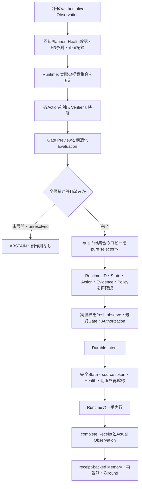

# Verified Multi-Candidate World Model Decision

PreActは、世界モデルの機能をモジュール化して再現し、認知・予測・シミュレーション・
意思決定・実行を統合するアーキテクチャである。本実装は、その一部分をQueue v2で
検証するopt-inの縦切りであり、Queueの評価関数を汎用認知アルゴリズムとして固定しない。
機能的完成を通常の性能最適化より優先し、計算費用と失敗条件も記録する。

## 責務と接続

PR #12の一候補方式は、その候補がGateに拒否されると停止する。今回の方式は同じ
実観測から3候補を予測し、Runtimeが独立に検証したqualified集合だけから価値最大を選ぶ。
Core utilityは書き換えない。`candidate_selector=None`では従来の探索・選択を使用する。
新契約は`search=False`のflat root比較に限定する。直接実行との併用は拒否する。



| 層 | 所有する情報・権限 |
|---|---|
| `QueueMultiPlanner` | 監視付き予測と固定Goal価値。予測はINFERENCE |
| `Runtime` / `CandidateBatch` | 提案集合、各Evaluation、Gate Preview、qualified集合、完了判定 |
| `CandidateSelector` | コピーを読み、qualifiedなnode IDを一つ返すだけ |
| `QueueMultiSelectionWorld` | 最終選択後の完全State・モデル・出所を実行直前まで照合 |
| Runtime / Gate | fresh Gate、Authorization、durable intent、一手実行、Receipt確定 |

selectorは同期の、信頼されたプロセス内拡張である。追加推論、API呼出し、World実行、
Store書込みは禁止する。入力コピーの変更、Runtimeの評価・Policy・予算・Registry宣言の
変更、現在runへのStore書込み、不正ID、例外、取消はfail closedとする。OS sandboxや
任意の悪意あるPythonコードの隔離を実装したという意味ではない。

## 候補の分類と完了証明

幅やnode数だけで完了とは判定しない。実際に提案したfingerprint集合と展開・検証結果を
照合する。既存TreeNodeの表示やGateの意味は変えない。

- `unexpanded`: 予算などによりnodeが作られなかった。
- `invalid_contract`: WorldのAction契約違反として明示的に拒否された。
- `unresolved`: nodeはあるが未評価、または必要なEvidenceを確認できない。
- `rejected`: 構造化Evaluationを既存Gateへ渡すとhard vetoでABSTAINとなる。
- `qualified`: 同じGate条件でEXECUTEとなる。

分類にはverification可能な既存Gateの構造化Decisionを使い、reason文字列を解析しない。
最終Previewではverification不可のGateを記録する。この区別により証拠不足とhard vetoを
分離する。未展開・unresolvedが一つでもあればselectorを呼ばずABSTAINする。
契約拒否・hard vetoは集合から除外できるが、qualifiedが空なら実行しない。

## 予測・選択・実行の別々の証跡

`cognitive_prediction`は完全State、Goal、固定評価関数、Model/Dataset/Health/view、
全Actionの予測・価値・順位、source run/tokenを記録する。`selected`は未設定であり、
予測上の第一候補を実行候補として偽装しない。

`candidate_qualification`は全提案と各Prediction/Evaluation/Preview、集合とhashを記録する。
`candidate_selection`はqualifiedからの最終node IDとState/fingerprint/Evidence/Policy bindingを
記録する。`cognitive_multi_dispatch`はintent後の実際のfresh StateとReceiptを結び付ける。
実行済みと扱えるのはcomplete receiptとActual Outcomeが確認されたActionだけである。

Healthがavailableで全予測が成立する場合だけ学習スコアを用いる。通常のデータ不足や
suspected/invalidatedでは既存`InformationQueuePlanner("no_probe")`の順位へfallbackする。
fallback候補も同じVerifier/Gateを通す。偽Receipt、source変更、推論例外、取消は通常の
情報不足として処理しない。取得したtimestampを捏造せず、正常な再観測による時刻更新だけを
許容し、それ以外の完全State・provenance・uncertaintyの変更は停止する。

PR #11の明示的Promotionと新監視episodeを維持する。旧モデルを復活させたり、同一episode
の途中で再学習・昇格したりしない。監視されない直接TemporalEngine経路には保証を拡張しない。

## 利用する最小API

既存の確定経験から構成した`MonitoredQueueSource`、実際の監視episodeの正式準備run、
Store/Artifacts/Worldを渡す。準備も既存Runtime・Gate・Receiptを通る。

```python
from preact.cognition import CognitiveAgent, Goal
from preact.cognition.queue_multi import QueueMultiPlanner
from preact.core.models import Policy
from preact.core.registry import Registry
from preact.domains.queue_multi_selection import QueueMultiSelectionWorld
from preact.engines.information_queue import InformationBoundVerifier

planner = QueueMultiPlanner(source, prefix_runs=preparation_runs)
world_view = QueueMultiSelectionWorld(world, planner)
agent = CognitiveAgent(
    store, artifacts,
    Registry([
        InformationBoundVerifier(world.task),
        InformationBoundVerifier(world.task, future=True),
    ]),
    planner,
    [Goal(name="Deliver", metric="delivered", target=world.target)],
    Policy(search=False, width=3, max_nodes=3, max_calls=128),
    candidate_selector=planner,
)
agent.memory.run_ids.extend(preparation_runs)
result = await agent.run(world_view, max_rounds=10)
```

予測比較はproposer内で行い、予約・実績の既存usage契約に従ってローカル呼出しを計上する。
selectorは計算済み順位を読むだけである。Verifier呼出しとローカル推論、外部APIを区別する。
CPU fixtureの外部API費用は0、計算資源のドル価格は不明であり0とは扱わない。
3候補を渡しても予算不足なら完了を偽装せず停止する。

## 検証と評価の再現

専用protocolは`benchmarks/queue-multi-selection-v2.json`。PR #12のH3評価関数と
検出設定を保持し、本評価前にseed・条件・重みを固定した。既存protocol/resultsは変更しない。
新規v1 pilotは回復評価4組が必須8組に満たず昇格拒否で停止した。v1を残し、
v2で回復評価専用seedを既存PR #12の4seedへ分離した。重み・閾値・環境・意思決定seedは
変更せず、成功結果に合わせた条件緩和は行っていない。

```sh
uv run pytest -q tests/test_queue_multi_selection.py tests/test_queue_multi_audit.py
uv run python -m scripts.benchmark_queue_multi_selection --pilot --output .cache/multi-pilot-new
uv run python -m scripts.audit_queue_multi_selection --output .cache/multi-pilot-new
uv run python -m scripts.benchmark_queue_multi_selection --output .cache/multi-main-new
uv run python -m scripts.audit_queue_multi_selection --output .cache/multi-main-new
```

出力先には毎回新しいdirectoryを使用する。Ledger・raw manifest・artifactはローカルの
`.cache`内に保持し、公開するのは集計JSONと監査件数だけとする。

通常Queueの8条件ではなく、通常7条件と別仕様の投入許可fixture1条件を評価する。
fixtureの公開queue boundはsubmit(3)を許すが、独立したmandatory `submission_permit`
検証が拒否し、submit(1)/drainはqualifiedとなる。これは通常Queueの安全仕様を変更しない。

6方式を同一seedで比較する。PR #12一候補方式だけwidth/node上限が1、他方式は3で、
呼出し・時間上限は共通。`core_utility_control`は同じ予測・検証を行ってutilityで選ぶ
明示的な交絡対照であり、既存Coreの標準方策を書き換えたものではない。
既存Planner/固定方策の対照も同じ複数候補検証経路を使用する。

閉ループでは実際に実行したActionの一tick予測だけをActual Outcomeと比較する。
H3のAction差分MAEは、別の正式branch実験で環境だけを3tick進めて測る。
未実行の反実仮想Actionへ実Outcomeを付けない。Health不足によるfallback-only条件、
成功/失敗、費用増、差なしを区別する。結果は[専用結果文書](queue-multi-selection-results.md)を参照。

## 限界と次の段階

本方式はflat root、3候補、H3、iid定常サービス仮定と既知の遅延規則に限定する。
全候補完了を要求するため、使える候補があっても未解決候補が残れば停止する。
独立監査はowned CPU fixture内で予測分布・価値・Gate・Receipt・時系列を再計算する。
これは任意の実世界の因果モデルや一般的な性能優位性の証明ではない。

次は複数候補の予算配分・部分的な検証完了の選択条件、相関と時間変化を扱う予測、
同一episodeでの回復契約を別々に設計する。自動昇格、Safety Authority変更、深い探索、
Software/Physicalへの強制適用、通常の高速化は今回の範囲に含めない。
