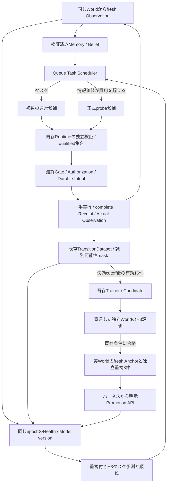

# Task-Aware Continuous Queue Adaptation — 設計と検証境界

公開main `d7927581c3bb8419c7fd2e4564f9e5ef253578ca`からの独立追加。
PR #14の100tick／タスク判断3回という結果は変更せず、比較基準として維持する。

認知層の`ScheduleDecision`は、タスク／情報取得Actionと学習・評価・昇格待ちの
推奨を記録するだけである。Queue固有の`QueueTaskPlanner`は既存の監視付き
H3タスク予測、receipt-backed MemoryによるBelief、公開到着規則から情報価値を
計算する。Core、Verifier、Gate、Authorization、Intent、Receiptは既存のまま使う。
候補検証を通過した集合内の選択はPR #13の契約を継承する。Probeだけを提案する
判断でも、独立検証・最終Gate・fresh observation・一手実行は省略しない。



情報価値は未校正の小さな近似である。能力1/3の二つの明示的な固定参照分布から、
同じState・Goal・既存評価関数の最善Actionと、現在のタスク候補の期待価値差を計算する。
Beliefのhigh確率で重み付けした差を、残りtickと宣言した持続性で制限した将来判断数、
必要な有効標本数で按分する。通常Actionが次tickに`available_work>=3`を持つ場合、
追加Probeの情報価値は0とする。Probeの費用と通常Actionを投入しない機会損失を引く。
条件付き最善Actionに差がなく、残り観測予算が足りない場合もProbeは選ばない。
これらはモデル仮定であり、環境の非公開scheduleを読んで計算するものではない。
参照予測6回と実モデル予測・昇格再検証の呼出しは既存proposal予約・usageへ計上する。
外部API費用はこのCPU環境で0、計算時間のドル換算はunknownとする。

学習には`QueueServiceAdapter`をそのまま使う。識別不能な通常Outcomeはmask=0であり、
低能力の教師に変換しない。学習16件、評価有効16件・Action比較8組、MAEとbaseline条件、
新監視Healthは既存Promotion契約を維持する。実Worldの未実行候補にActualラベルは付けない。
一手先の実測誤差と、独立評価WorldでのH3／Action差分誤差は別々に報告する。

昇格操作は実験ハーネスの明示呼出しとして耐久記録する。production Schedulerに自動
昇格の権限はない。通常の統計的不足はタスクFallbackへ移れるが、Receipt破損、取消、
Store変更、昇格根拠喪失、推論例外は伝播して停止する。昇格済みRecoveryが無効化されても
未昇格Guardへ戻らないPR #14の修正を維持する。

pilotを先に実行し、その後、新しい本評価protocolと最低タスク実行条件を固定する。
既存の凍結済みprotocolや過去結果は変更しない。時系列相関、選択バイアス、検閲、
未校正の情報持続性、独立評価の環境対応は限界として結果とともに記録する。

## 再現と使用

```sh
uv run python -m scripts.benchmark_queue_task \
  --protocol benchmarks/queue-task-v1.json \
  --output /tmp/preact-task-NEW --report /tmp/preact-task-NEW-results.json
uv run python -m scripts.audit_queue_task \
  --bundle /tmp/preact-task-NEW --protocol benchmarks/queue-task-v1.json \
  --results /tmp/preact-task-NEW-results.json --output /tmp/preact-task-NEW-audit.json
```

出力bundleにはローカルDB、モデルArtifact、元Receiptが含まれるため公開PRに入れない。
公開するのはprotocol、集約results、集約auditである。新しい出力先を指定し、
凍結済み過去結果を上書きしない。Benchmark開始・終了時のsource hashが一致しない
場合は結果の確定を拒否する。単一固定seedであり、通常条件の反復は一般化性能の証明にならない。

既存の`ContinuousQueueAdaptation.selection_source()`から取得したsourceと、現在epochの
run manifestを`QueueTaskPlanner`へ渡し、`QueueMultiSelectionWorld`で実Worldを包む。
`CognitiveAgent(..., candidate_selector=planner)`を使い、`search=False / width=3 /
max_nodes=3`のPolicyと独立した`InformationBoundVerifier`群を指定する。
`episode_memory_runs`には実episodeのMemory用run manifestを明示する。
学習・評価・昇格は`ContinuousQueueAdaptation`のAPIの責務として保持する。
実例は`scripts/benchmark_queue_task.py:decision`を参照する。

最初の不足を補うProbeも全て評価horizonに含める。十分な標本が無ければモデルは
利用不可のままで、Fallbackのみの期間も記録する。`submit(0)`はdrainであり通常Action
率に含まれるため、Goal達成前のモデル利用数、仕事を進めたAction数、deliveredも別に報告する。
外部API呼出しは0、CPU計算のドル換算は不明であり0と解釈しない。

## 保証範囲と限界

Store/Receipt/Stateの検証と更新tokenのfenceは既存の単一所有者・append-only境界内である。
強い分散トランザクション保証や任意の外部Worldの認証を追加していない。
単一World内のanchor/epochの継続性は既存lifecycleに委譲する。
Plannerによる情報価値は未校正であり、時間相関・Policy選択バイアス・検閲を除去しない。
二つの参照能力分布と持続性0.95による近似はPOMDP最適解ではない。

`QueueServiceAdapter`は通常Actionのavailable_work>=3だけを能力教師にする。
別のBayesian Beliefが仕事量2から能力1/3を区別できる場合でも、Trainerの教師契約は
変更しない。このためタスクを進めても回復用の有効標本が不足する条件がある。
独立評価環境のregimeは実験operatorが設定する。未知の実環境について適切な独立
評価Worldを自動生成する能力は未実装である。

`probe_cost`と`submission_cost`はGoal Utility／Rewardの単位である。
ローカルAPI費用USD=0は、Probeの情報取得が無料という意味ではない。
Probeは1実tickと設定したReward費用を必ず消費する。
既存Policyの呼出し・期限・USD予算は各正式Runtime roundで適用し、
今回のハーネスは別途固定220tick（診断例では70tick）で停止する。
独立評価Worldの実行・計算は別に記録し、source Worldの仕事として合算しない。
